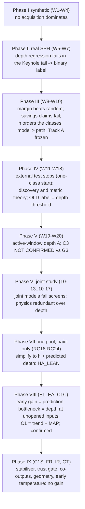

# Thesis synthesis: what the research found, why each step followed, and what it rests on

Written on 2026-11-02 at the close of the research, before thesis writing. It connects every study into one argument. Each statement points to the record that holds its evidence. Numbers are copied, never recomputed.

Companion files:
- [STUDY_INDEX.md](STUDY_INDEX.md): every study in one table.
- [CLAIMS_FOR_THESIS.md](CLAIMS_FOR_THESIS.md): the wording each claim may and may not use.
- [OPEN_ITEMS_REGISTER.md](OPEN_ITEMS_REGISTER.md): every open point, with its final status.
- [GLOSSARY.md](GLOSSARY.md): identifiers. Several short names were reused; read §1 of the glossary first.
- [REPOSITORY_MAP.md](REPOSITORY_MAP.md): branches, folders, data and how to reproduce.

## 1. The answer in one paragraph

**Question.** In laser powder-bed-fusion SPH simulations, the melt pool is either in the Keyhole regime or in conduction. Which runs should be simulated so that the boundary between the two is learned with as few runs as possible?

**Answer (one pool of 541 simulations).** The best learner is a two-stage model with plain uncertainty sampling, **C1 + margin**:
- **Stage 1:** a Gaussian-process emulator of the maximum melt-pool depth with a linear physics trend in the log process score z_h, with hyperparameters estimated as a MAP under a fixed weak prior.
- **Stage 2:** a logistic classifier on [z_h, predicted depth] with learned regularisation and honest out-of-fold stacking.

**Gains over the frozen reference HA_LEAN + margin**, on 80 fresh repeats (C1C):
- it learns earlier: BA-AULC over budgets 8–24 is +0.0053 [+0.0039, +0.0068];
- it reaches BA 0.95 with 1.8 fewer simulations: +1.81 [+0.53, +3.09];
- it loses nothing late: B28–B60 −0.0006, preserved within 0.003.

**Where the gain comes from.** The model, specifically better depth predictions at inputs that have not been simulated. It does not come from the acquisition rule: no tested acquisition rule beat margin once the model was fixed.

**What remains is an information limit.** It sits at unopened inputs and in a label-interleaved fast-scan corner. None of the following removes it:
- other physical outputs (temperature, flow, kinetic energy, width);
- geometric ratios;
- early temperature;
- stabilisers or trust rules.

**Scope.** Every result is a re-split of the same simulation pool. External validation on new simulations was attempted once (Week 11), stopped by a one-class start, and remains future work.

## 2. The problem as it was finally posed

| Element | Final form | Record |
|---|---|---|
| Inputs | laser power P, scan speed VX, spot radius LS, substrate temperature ST (4-D) | `docs/alse/data.md` |
| Physics coordinate | h = P / √(VX · LS³) (units W·s^½·m⁻²; not dimensionless); z_h = standardised log h | C20, C103 |
| Label | `has_keyhole` = any frame with the manual label `Keyhole` | Week 7 Phase 1 |
| Pool | 541 runs = OLD 405 (73 Keyhole, `sph_v2@b6dc254a`) + NEW 136 (124 Keyhole, `@2e1eec9c`); 197 Keyhole in total; 22 short-Keyhole runs | RC19 protocol; IR |
| Learning protocol | start from an 8-run maximin design, buy one simulation per step up to budget 60; the learner sees only paid outcomes; every opened run counts, the startup included | RC19 to GT protocols |
| Evaluation | held-out fold BA; BA-AULC early B8–B24, late B28–B60; simulations to reach and confirm BA 0.90 / 0.93 / 0.95; log loss, Brier and CPU as harm limits; geometric blocks K5 / K4 for extrapolation | EA / C1C protocols |
| Registration | protocol, rule and fresh repeat IDs committed before any outcome; attempt ledgers; errata only | `outputs/joint_depth_label_development/ATTEMPT_LEDGER.md` |

**What "sample-efficient" means here.** It is measured in two ways:
- the area under the BA learning curve in the early window;
- the number of paid simulations needed to reach and confirm a BA target.

The early Week 8 headline "40 saved calls, 2.33×" failed its frozen confirmation (Week 8.5, C16–C17) and must not be used. Savings are only claimed where a registered, own-path design measured them (EA, C1C).

## 3. The final method and its reference

| | **C1 + margin (recommended in-pool learner)** | **HA_LEAN + margin (frozen reference)** |
|---|---|---|
| Depth emulator | GP, Matérn-3/2 ARD; mean = θ·z_h with θ ~ N(0, 3²) integrated (universal kriging); hyperparameters MAP under log s_f² ~ N(0, 1.5²), log ℓ ~ N(0, 1), log s_n² ~ N(log 0.01, 1.5²); two fixed starts | GP, constant mean; hyperparameters ML-II |
| Data for the emulator | paid depths only | paid depths only |
| Classifier | logistic regression on [z_h, D̂]; regularisation strength learned by the Laplace evidence; D̂ from honest K = 10 out-of-fold stacking; one-class rule | same |
| Acquisition | margin: the unopened run with p closest to 0.5 | same |
| Code | `src/ea_cand.py` (`SYSTEMS["C1"]`), `src/ea_fwd.py` | `src/rc23_*`, `src/el_cross.py` |
| Decision | C1C (claims C123–C130); kept by C1S, FR, IR, GT | RC23 decision D1 (C81); kept by RC24 post-audit and EL |

**Why each component is there.** Each was earned by a registered comparison, in this order:
1. **log h:** it orders the classes (Phase 1.5) and is material in the classifier (RC20, C48).
2. **Predicted depth:** it improves probability quality beyond log h (RC23, C84). An h-only learner does not keep BA 0.95: it attained it in 5/8 repeats against 7/8 for the system with depth (RC24, C88).
3. **Learned regularisation:** needed (RC21–RC22).
4. **No temperature or flow:** they add nothing once log h and depth are in (RC22–RC23, C77, C85).
5. **The physics trend:** it gives an early gain, which is a prediction effect (RC24, EL, C109).
6. **The MAP prior:** it removes the trend model's small-sample ML-II artefact, which caused a late loss and a log-loss penalty (EA, C117; C1C, C129).

No component is new. C1 combines known pieces: universal kriging, GP hyperpriors, stacking, Laplace logistic and uncertainty sampling. The thesis contribution is the measured combination and the diagnostic evaluation (C108, C114, C122, C130).

**When to prefer the reference.**
- **Extrapolation to an input region with no paid runs:** HA_LEAN is safer on K5-type blocks (EA: C1 − A per-region −0.049). FR showed this advantage is design-dependent: K5 yes, K4 no (C143).
- **Staying above 0.95 for the whole budget:** sustaining did not improve (C126).
- **Non-standard startups:** keeping 0.95 was not shown non-inferior under random or clustered starts (C1C caveats).

## 4. The research arc: seven turning points

Each turning point names the result that forced the next step.

### T1 — From regression to a binary boundary (Week 7)

- **Observed.** On `sph_v2`, GP depth regression has heavy-tailed, Keyhole-concentrated errors: Keyhole RMSE 32.9 µm against 9.8 µm for the other runs; the worst 10 cases hold 67.8 % of the squared error (C37). A depth-threshold proxy (G3 target) has no universal threshold (C06, C07).
- **Consequence.** The thesis target became the binary Keyhole label, learned directly. Depth was kept as a companion scalar. This choice is reversed in part at T4 and T6, once depth is predicted and not thresholded.

### T2 — Margin works; savings claims do not; the model matters more than the path (Weeks 8–10)

- **Observed.**
  - Uncertainty sampling (margin) beats random on near-boundary accuracy under a frozen protocol (Week 8.5, C01).
  - The saving and multiplier claims fail (C14–C17).
  - The physics coordinate h explains most of the class separation (C20–C21).
  - Physics-informed surrogates help (M1, M3; C22–C28), and the decomposition shows the gain is in the model, not in the query path (Phase 1.8, C23).
  - Every more elaborate acquisition rule (repulsion, correction signal, PA-TVR, FAST and exact GPC-SUR) failed against margin (C29–C35).
- **Consequence.** Effort moved from acquisition to models. Track A was frozen with M3 + margin as the historical control (Week 10). This "model, not acquisition" pattern recurs at every later stage (RC22 C75; RC24 C91; EL C109; EA C115).

### T3 — The NEW batch and the limits of evaluation (Weeks 11–17)

- **Observed.**
  - The frozen external validation on Ioan's NEW batch stopped: one B16 start was one-class (Week 11). It produced no effect estimate.
  - NEW differs: 12 of 136 runs are conduction, and a fast-scan corner (VX > 0.85) mixes both labels.
  - Theory (Weeks 13–16):
    - discovering the rare class needs a structural assumption;
    - finite-pool boundary metrics are density-weighted;
    - the oracle headroom of acquisition is invisible to the model.
  - No model or acquisition change was justified (Week 17).
- **Consequence.** The question became: what carries the label information? Week 18 re-examined the assumptions.

### T4 — The label is a depth threshold on OLD; depth becomes the carrier (Weeks 18–20)

- **Observed.**
  - On OLD, `has_keyhole` equals "maximum depth above about 111 µm" (AUC 1.000).
  - A depth GP + straddle (E1) beats G3 + margin there: +0.0285 on Week 18 block C1; the C2 replication of +0.016 is below the +0.02 bar (Week 18).
  - On NEW the label is not a depth threshold (AUC 0.891; fast scans).
  - Ioan's temporal question led to the active-window depth A, which is clearly better than the whole-record depth (C3: ACTIVE − WHOLE +0.044).
  - A's superiority over G3 was not confirmed (C3: +0.007 [−0.036, +0.053]).
- **Consequence.** Predicted depth is the main label carrier, but a depth threshold alone cannot be the classifier. The next step joined depth and label in one model.

### T5 — Joint models fail; the one-pool programme simplifies to h + depth (joint study, RC18–RC23)

- **Observed in the joint study.**
  - Astra's joint depth–label models failed their screens: J +0.006 BA, V2 −0.002.
  - Physical outputs are learnable from the inputs, but redundant once depth is modelled (pilot P5: E1_AUX − E1 ≈ 0).
  - No model resolves the fast-scan corner (L2, C54, C67).
- **The owner then fixed a stricter protocol (RC18 / RC19):** one pooled 541-run pool, learning from scratch, only paid outcomes, every run counted.
- **Each campaign removed what did not pay:**
  - RC20: log h is material; the shared upstream emulator is not (C46, C48).
  - RC21: learned regularisation improves probabilities but not decisions (C60–C63).
  - RC22: temperature and spike features are useless after h + depth; an information-gain selector loses to margin (C75, C77).
  - RC23: the fully lean system, h + predicted depth with a depth emulator fed by paid depths only, is non-inferior, robust and 3× faster (C81–C84).
- **Consequence.** HA_LEAN + margin became the thesis learner (decision D1). Its remaining weakness was early learning.

### T6 — The physics trend helps early, ML-II spoils it, MAP repairs it (RC24 → C1C)

- **RC24.** Adding the physics trend θ·z_h to the depth emulator (HA_TREND) gave an early gain. It also brought a log-loss penalty and a late loss, so the final comparison kept HA_LEAN (C106).
- **EL.** Crossing selectors with predictors showed the early gain is a prediction effect: on the same paths, a better predictor does better (C109). Turning the gain into savings at BA 0.95 failed with the existing estimators (C110, C112).
- **EA attributed the error.**
  - The dominant limit is the depth at unopened inputs: a true-depth oracle adds +0.040 early, ideal hyperparameters only +0.005, unlimited data +0.022 (C115, C116).
  - HA_TREND's late loss is an artefact of ML-II at small n: hyperparameter bounds are hit in most early fits (C117).
  - A fixed weak hyperprior with MAP estimation (C1) removed the artefact.
  - The same prior on the constant-mean GP hurt (C121), so the gain needs the trend.
- **C1C.** The registered 80-repeat replication passed every verdict (C123–C130).
- **Consequence.** C1 + margin is the recommended in-pool learner. HA_LEAN + margin stays the frozen reference.

### T7 — The remaining gap is an information limit (C1S, FR, IR, GT)

- **C1S.** C1's late dips below 0.95 are balanced boundary flips. Most of the shortfall is a persistent level deficit of hard folds, not noise. A probability-averaging stabiliser smooths the curve but costs simulations at 0.95, so it was not adopted (C131–C138).
- **FR.** An oracle choosing between C1 and HA_LEAN would gain on geometric blocks, but no paid-only rule can tell which model is right where nothing was opened (C139–C144).
- **IR.** Ioan's request: physical outputs and width relate to depth, mostly through the inputs. With true values none adds label information beyond h + depth. Co-output depth emulators failed the matched screen (C145–C150).
- **GT.**
  - Label-free classifiers from predicted depth and width with the physical rule d/w = 1/2 are clearly below C1: the best is −0.0174 early. The fixed threshold sits at the edge of the conduction cluster, so prediction smoothing pushes conduction runs over it.
  - Early temperature adds nothing, either for choosing runs or for judging a started run (C151–C158).
- **Consequence.** The research stopped here. No registered candidate remains, and the fresh IDs STD 383+, K5 49+, K4 33+ are unused.

## 5. Mechanisms the thesis can explain

| Mechanism | Evidence | Records |
|---|---|---|
| Gains come from the model, not the query path | Phase 1.8 model +0.021 / path −0.001; EL prediction effect +0.0053 on HA_LEAN paths; EA C1 − HA_LEAN on identical paid data +0.0098 (40/40), path effect ≈ 0 | C23, C109, EA report |
| Margin is hard to beat once the model is fixed | Week 8.5 (vs random); Phase 1.14–1.18B; Week 15 EBR-D; Week 17 PEER; RC22 BALD; RC24 principled straddle; RC20 η-straddle | C01, C29–C35, C57, C75, C91; W15, W17 |
| The exception to margin is rare-class discovery | Week 17: on NEW (post-hoc), random / Candidate B / PEER beat margin by 0.01–0.03 BA AULC under G3 and LT, because the rare pocket must first be found | W17 report §5; W13–W14 theory |
| Small-sample ML-II artefacts in trended emulators | EA: bounds hit 100/100/95/75/45 %, noise collapse 80 → 20 %; D2T oracle; C1 removes the late loss | C117, C129 |
| Information limit at unopened inputs | EA rung ladder; FR (paid OOF evidence cannot reveal the right model in an unopened region); C1S level deficit | C115–C116, C132, C142 |
| Label-interleaved fast-scan corner | NEW VX > 0.85: 23 runs, 11 conduction / 12 Keyhole, all 10 NEW short-Keyhole; every model 0.45–0.60 BA inside; margin spends many queries there | L1–L2, C54, C67, C92, C93 |
| A fixed physical threshold on predicted geometry is biased | the true g = 0 sits at the conduction cluster's edge (q95 −0.03) while Keyhole starts at +0.27; smoothing over-calls Keyhole | C154 (post-hoc) |
| Finite-pool metrics are density-weighted | Week 14 theorem and benchmark | W14 report |

## 6. Limits that travel with every claim

1. **One pool.** OLD and NEW are two campaigns of one simulator. Every repeat ID is a new split of the same 541 runs. **No result is external or physical validation.** The Week 11 external test stopped. The C1C external plan (`EXTERNAL_VALIDATION_PLAN_C1C.md`) was written but not run: the owner stated that no new simulations would come before writing.
2. **The pool was inspected during development.** The C1 prior was chosen after full-pool ML-II diagnostics had been seen (C1C caveat). Fresh repeat IDs remove selection on outcomes, not this design exposure.
3. **The fast-scan corner is unresolved.** Resolving it needs new simulations inside the corner.
4. **Sustaining BA 0.95 was not improved.** The 0.95 saving comes mainly from more learners attaining the target.
5. **Extrapolation:** HA_LEAN is safer on K5-type regions, but the advantage is design-dependent.
6. **The ~300 µm Keyhole depth plateau** (134 of 197 Keyhole runs) is a hypothesis about the domain floor, unverified because no file holds the domain z-extent.
7. **Astra's synthetic campaigns** are separate evidence about synthetic worlds; they do not validate physical Keyhole labels (Research Hub, C1S / FR addenda).
8. **No methodological novelty is claimed** for C1 or any learner (C108, C114, C122, C130). The contribution is the measured combination and the diagnostics.

## 7. How the studies depend on each other

| Later study | Uses from earlier studies |
|---|---|
| Week 8.5 | the binary target (Week 7); `binary_margin` (Week 8) |
| Week 9 | the frozen Week 8.5 protocol and its A0 path for replay |
| Week 10 / Track A | M3 (Phase 1.13), Candidate B (Phase 1.21) |
| Week 11 | the Track A frozen candidate; Ioan's NEW batch |
| Week 12–17 | the NEW-136 runs (post-hoc), Week 8.5 / Week 12 predictions, Astra's theory |
| Week 18 | OLD + NEW pooled tasks; the frozen block design (DEV, C1, C2, C3) |
| Week 19–20 | Week 18 caches (fidelity ≤ 6e-6); block C3 |
| Joint study | the Week 19 paths (NEW Stage M paths identical, S4); Astra's joint models |
| RC18 | the NEW monitors (Week 18 grant D1; downloads of 10-16) |
| RC19–RC24 | the one-pool reveal interface `src/rc19_pool.py`; RC18 data layer |
| EL | the recorded HA_LEAN / HA_TREND paths of RC24 |
| EA | the recorded HA_LEAN paths of EL (repeats 123–162) |
| C1C | C1 unchanged from EA; fresh IDs 203–322 |
| C1S | C1C units; fresh IDs 323–382 |
| FR | EA and C1C exports at identical paid prefixes |
| IR, GT | the 272 recorded EA C1 paths (`ea-fwd` units; preserved copy in the local archive, see REPOSITORY_MAP) |

## 8. Suggested thesis structure and where the evidence is

The outline is a suggestion; each section names the records to draw from.

| Chapter | Content | Main records |
|---|---|---|
| 1 Introduction | Keyhole defects in LPBF; simulation cost; active level-set estimation question | `docs/alse/overview.md` |
| 2 Background | GP regression and classification; uncertainty sampling, straddle, SUR; normalised enthalpy and h; finite-pool evaluation | W14 theory; literature notes `opus_rc24/literature/LITERATURE_MATRIX.md`, `opus_rc24/post_audit/ORIGINALITY_AND_LITERATURE.md`, `opus_early_learning/LITERATURE_EL.md`, `opus_error_attribution/LITERATURE_EA.md`, `opus_ioan_requests/LITERATURE.md`; Week 9 `outputs/week9_phase1_23_method_validity/LITERATURE_NOVELTY_AUDIT.md` |
| 3 Data and problem | SPH simulations, OLD and NEW, labels, physical targets, the 541-run pool, the paid-only protocol, metrics, repeat-ID design | `docs/alse/data.md`, `docs/alse/protocol.md`, Week 7 audits, Week 19 audit, `PROTOCOL_RC19.md`, `PROTOCOL_C1C.md` |
| 4 Synthetic benchmarks | Weeks 1–4: acquisition families, near-boundary metrics, no universal winner | decisions rows 06-22 to 06-29; C10, C39, C40 |
| 5 Binary boundary on real data | Weeks 7–10: binary target, margin vs random (frozen), h, M3, failed acquisition variants, Track A | Week 8.5 ledger; Week 9 phases; Track A freeze; C01–C36 |
| 6 What limits learning | Weeks 11–20: external stop, discovery and metric theory, depth as label carrier, NEW fast scans, active-window depth, C3 | Week 11–20 reports; this file §4 T3–T4 |
| 7 Two-stage depth-then-label learning | RC18–RC24, EL, EA: simplification to HA_LEAN; trend emulator; error attribution; C1 | RC reports; EL and EA reports; C41–C122 |
| 8 Confirmation and robustness | C1C replication; C1S stability; FR extrapolation; IR and GT supervisor questions | C1C, C1S, FR, IR, GT reports; C123–C158 |
| 9 Discussion | model vs acquisition; information limit; the corner; what new data would test; limitations (§6) | this file §5–§6; OPEN_ITEMS_REGISTER |
| 10 Conclusion and further studies | the answer of §1; then the **Further studies** section below (owner decision 2026-11-03) | this file §1, §6; `EXTERNAL_VALIDATION_PLAN_C1C.md` |
| Appendices | integrity method (registration, freezes, ledgers, errata), negative results, glossary, reproducibility, Astra's track | ledgers; `docs/trackA_freeze/NEGATIVE_RESULTS_REGISTER.md`; GLOSSARY; REPOSITORY_MAP |

**Further studies.** On 2026-11-03 the owner decided that these questions go into the thesis as a "Further studies" section. They will not be run before writing.

Each question is one that the 541-run pool cannot answer. The run blocks are those of `outputs/research_campaign_20261026/opus_c1_confirmation/EXTERNAL_VALIDATION_PLAN_C1C.md`: 176 runs, 152 at minimum. That plan was never sent and no run was started.

1. **Generalisation to new runs (V1: 136 new runs over the same input ranges).**
   - Question: does the early gain of C1 + margin over HA_LEAN + margin hold on simulations that played no part in any design choice?
   - Why the pool cannot answer it: every result so far re-splits the same pool, and the C1 prior was chosen after the full-pool diagnostics.
   - Caveat: one 136-run batch may be too small to detect an effect of +0.005 BA-AULC, so a non-confirmation would be inconclusive.
2. **Extrapolation (R3: 16 runs with the spot radius 10 % outside the pooled range).**
   - Question: is C1 safe outside the sampled region, or should HA_LEAN be preferred there?
   - Background: EA gave a K5 per-region warning of −0.049, and FR found HA_LEAN's advantage there design-dependent.
3. **Determinism of the fast-scan corner (R1: 8 corner inputs × 3 solver seeds; optional R2 ramp-up probe).**
   - Question: does the label flip between solver seeds?
   - If the flip rate is ≥ 0.2, the corner is aleatoric. The remaining error near it is then a data ceiling, not a learner failure.
   - R2 would test whether the short keyhole is a ramp-up overshoot.
4. **The 49 Bug-withheld NEW runs.**
   - They carry the "Screenshot Bug" annotation: late onset, cause unknown, never opened.
   - If Ioan confirms the label is unaffected, they can serve as a small untouched external check under a protocol frozen before opening.
5. **The ~300 µm Keyhole depth plateau.**
   - Question: is it the domain floor (z-extent), and does the ceiling affect learning?

**Figures for the main result** (`docs/final/figures/`, drawn on 2026-11-02 from the frozen C1C exports by `python -m src.fin_figures`; every plotted summary is checked against the reported numbers in `FIGURE_CHECKS.json`, and the plotted values are in the matching `*_data.csv`):
- `fig_final_1_learning_curves`: BA vs paid simulations, C1 + margin and HA_LEAN + margin, 95 % cluster-bootstrap bands.
- `fig_final_2_paired_difference`: ΔBA per budget with the early and late windows.
- `fig_final_3_attainment_095`: share of learners that reached and confirmed BA 0.95 within b simulations.

**Other figures.** The C1C, EA and C1S records hold tables, not figures. Their exports in `evaluation/` and `exports/` are enough for any further plot, and no new run is needed.
- GT: `outputs/research_campaign_20261102/opus_geometry_temperature/figures/`.
- RC18: `report/` figures.
- Week reports: their own `figures/` folders.
- Local only, in the canonical folder and not in git: the Week 10–18 advisor deck (`outputs/week10_18_presentation/`, with a .pptx and an interactive HTML) and the 30 October meeting site (`30-10-2026_ioan_meeting.html`).

## 9. Reading order for the writer

1. This file, then GLOSSARY §1.
2. `outputs/research_campaign_20261026/opus_c1_confirmation/DECISION_C1C.md`: the final decision and its caveats.
3. `outputs/research_campaign_20261026/opus_error_attribution/FINAL_REPORT_EA.md`: the mechanism.
4. `outputs/research_campaign_20261021/opus_rc23/FINAL_REPORT_RC23.md` and `opus_rc24/post_audit/FINAL_REPORT_RC24P.md`: why the lean system and why not the plain trend.
5. `outputs/week18_independent_research/REPORT.md` and `outputs/week20_active_temporal_development/DEVELOPMENT_REPORT.md`: the depth turn.
6. `outputs/week8_5_frozen_confirmation/` and `docs/trackA_freeze/TRACK_A_FINAL_STATE.md`: the historical baseline.
7. [CLAIMS_FOR_THESIS.md](CLAIMS_FOR_THESIS.md) while writing each chapter.
