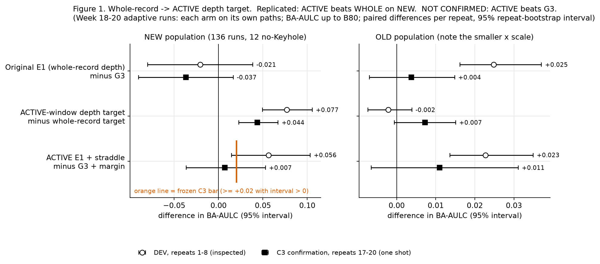
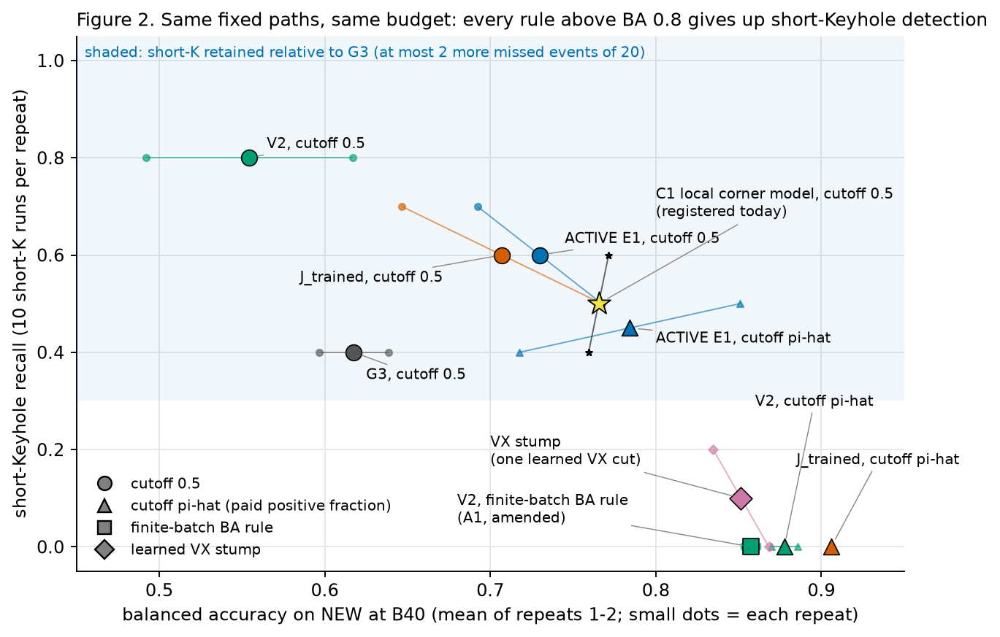
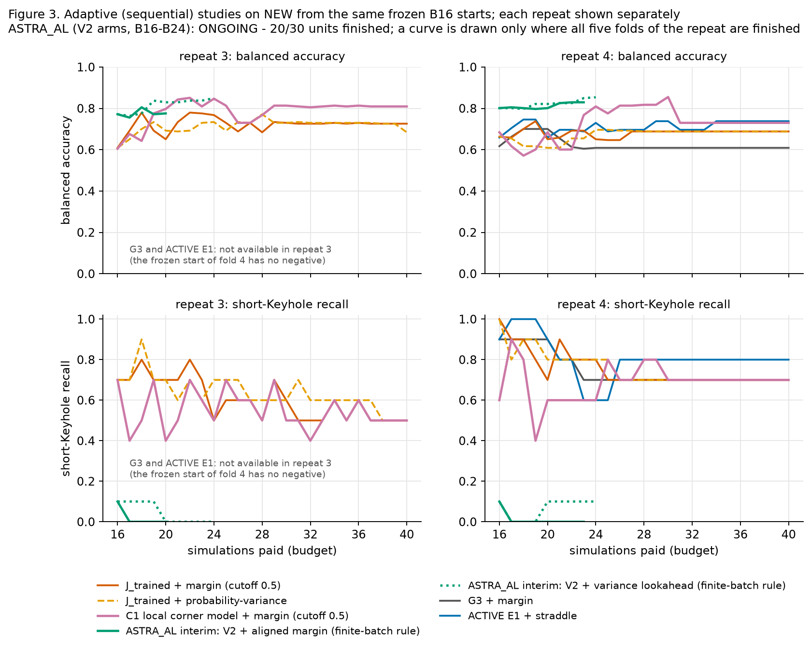

# Research update for Ioan — 15 October 2026

*Snapshot written for the meeting. The data are NEW-136, simulations that were all inspected before. Everything below is development evidence, not confirmation. Branch `joint-depth-label-dev` (not merged).*

## 0. Correction first

**The original E1 advantage was on OLD; universal superiority was not established.**
- Whole-record E1 beat G3 on **OLD** (DEV repeats 1–8: BA-AULC +0.025 [+0.016, +0.037]). On **NEW** it did not (−0.021 [−0.080, +0.039]).
- The ACTIVE-window depth target then repaired NEW relative to the whole-record target. This replicated in the one-shot C3 block: +0.044 [+0.023, +0.067].
- **C3 did not confirm ACTIVE E1 + straddle against G3 + margin on NEW.** The result was +0.007 [−0.036, +0.053], against a frozen bar of ≥ +0.02 with the interval above 0.
- C3 is spent, and this failed superiority result stands. Any earlier sentence that read as "E1 is generally better than G3" is withdrawn.

## 1. The question this week

Find and test a method that **improves on G3 + margin while keeping short-Keyhole (short-K) detection**. Then, only if a properly designed experiment supports it, show that it reaches useful performance **with fewer simulation queries**.

The structure of NEW that drives every result below:
- NEW has 124 Keyhole runs and 12 no-Keyhole runs.
- Outside the fast-scan corner (VX > 0.85 m/s; an evaluator-only description), at cutoff 0.5 and B40, every model classifies every Keyhole run correctly. The only error outside the corner is one early-ended slow scan without depth: a no-Keyhole run that every model calls Keyhole. Its label is kept.
- **Inside the corner** there are 23 runs: 11 no-Keyhole and 12 Keyhole. All 10 short-K runs of NEW are among those 12. There, every model and every decision rule so far has BA 0.45–0.60.

So "better BA" and "keeping short-K" pull in opposite directions unless a model can tell the corner runs apart.

## 2. Three figures

### Figure 1 — Whole-record → ACTIVE depth target, with C3 stated correctly

- These are adaptive Week 18–20 runs, each arm on its own paths, with BA-AULC up to B80 and paired differences per repeat.
- Open circles are DEV (repeats 1–8, inspected). Filled squares are the one-shot C3 confirmation (repeats 17–20).
- **Replicated:** ACTIVE beats WHOLE on NEW.
- **Not confirmed:** ACTIVE beats G3 on NEW. The DEV +0.056 shrank to +0.007. That is consistent with sampling variability and with DEV optimism, since the ACTIVE target was defined after the NEW labels had been seen.
- On OLD, the whole-record E1 advantage was clear in DEV (+0.025) but small in C3 (+0.004).
- Source: `outputs/week20_active_temporal_development/{track1_ext/contrasts_r1_8.csv, c3/contrasts.csv}`.

### Figure 2 — Strongest fair model comparison, including short-K retention (fixed paths)

- **Setup:** fixed feature-only paths (not adaptive). Every system sees the same paid runs: Week 19 maximin prefixes, NEW, DEV repeats 1–2, B40.
- **The trade-off is the whole story so far:**
  - Rules that raise BA above about 0.8 do so by labelling (almost) the whole corner "no Keyhole". That includes J_trained with the π̂ cutoff (BA 0.906), V2's finite-batch BA rule (0.858, amended A1), V2 at π̂ (0.878) and a one-cut VX stump learned from paid labels (0.851).
  - Those rules detect 0–1 of 10 short-K runs.
  - Systems inside the shaded band (short-K no more than 2 events of 20 below G3, or better) stay at BA 0.55–0.78. The best of them is ACTIVE E1, at 0.730 with cutoff 0.5 and 0.784 with π̂. Today's C1 model (star) sits at 0.766 with short-K 0.50.
  - π̂ is the paid positive fraction. Applied to ACTIVE E1 it is a descriptive secondary rule, not a frozen comparison.
- A decision-rule gain is not new information. These BA gains move the cutoff on the same posterior.
- Sources: `v2_model_comparison/metrics_per_repeat.csv`, `v2_decision_audit/A1_extended_ladder/metrics_per_repeat.csv`.

### Figure 3 — Sequential (adaptive) learning curves

- **Setup:** adaptive studies from the same frozen feature-only B16 starts (NEW, DEV repeats 3–4). Each repeat is drawn separately, and no ranking pools repeats across arms that exist on different repeats.
- In repeat 3 the frozen start of fold 4 contains no negative, so G3 and ACTIVE E1 are "not permitted" by protocol. Their repeat-3 curves, and every contrast that needs them, are **unavailable**.
- **ASTRA_AL (V2 arms, B16–B24) is ongoing.** Only complete repeats are drawn.

## 3. What ran today (all registered before outcomes; §6 lists commits)

| Study | What it tests | Status | Result so far |
|---|---|---|---|
| **TRAINED_AL** (Experiment B) | J_trained (response prior re-trained by ML-II on paid depths at every step), with margin or probability-variance selection, against G3 + margin and ACTIVE E1 + straddle; B16–B40 | **Complete** (40/40) | **Primary contrast unavailable** (single-class start, above). J_trained: probability-variance − margin BA-AULC −0.008 [−0.029, +0.013], so selection made no difference. At B40, BA 0.707 / 0.686, short-K 12/20, AUC 0.93. Repeat 4 only (descriptive): BA-AULC G3 0.625, ACTIVE E1 0.714, JT-margin 0.681, JT-PV 0.672; short-K AULC 0.746 / 0.806 / 0.748 / 0.752. No arm reached the target. |
| **ASTRA_AL** (Experiment A) | Astra's real-data policy: BA-risk lookahead vs integrated-variance lookahead vs aligned margin, all on V2 + finite-batch BA rule; B16–B24 | **Running** (20/30 units; see §4) | No result yet. **P1 and S1 are unavailable by protocol**, because two aligned-margin trajectories hit preserved numerical stops. The complete V2 + variance arm has high BA (BA-AULC 0.815 / 0.821) but short-K near 0 (AULC 0.04 / 0.06), the same trade-off as Figure 2. P2 (BA-risk − variance) waits for BA_RISK. |
| **CORNER_LOCAL** (Experiment C1) | Can a model learn the corner? A VX region learned from paid labels, with its own GP classifier inside, J_trained elsewhere. The decisive control permutes the labels inside the region | **Complete** (11/11; one technical repair before evaluation, v1.1) | **Local discrimination NOT SUPPORTED.** Corner AUC at B40 against the permuted control: +0.159 [−0.178, +0.475]. **System: no practical difference** against J_trained + margin: BA-AULC 0.757 vs 0.703, +0.054 [−0.056, +0.152], with short-K equal at B40 (12/20). Repeat 4 only: +0.101 [+0.030, +0.180] over G3, with equal short-K (7/10 each). By B40 nearly the whole corner of each training pool is paid, and held-out corner runs are still predicted near chance. |
| **STOP_RULE** (Experiment C2) | Learner-side stopping (stabilizing predictions, standard parameters) on the two completed J-family arms; decisive control = a fixed stop at the same mean cost | **Complete** (20/20) | The rule stops at about B30 (22–37) and saves **about 10 of 40 queries** with no material loss relative to continuing to B40. J_trained + margin: BA +0.002 [0.000, +0.006], short-K 13 vs 12 of 20. **The decisive control explains it:** a fixed stop at B30 does as well (J_trained: identical) or better (C1: +0.062 BA). The late queries bought nothing, and the adaptive rule is not the reason. This is a statement about the schedule, not about useful performance; the registered target was never reached. |

## 4. Answers so far

**(1) Is there an improvement beyond the strongest candidate? Not established.**
- **Fixed paths (Figure 2).** The strongest system that keeps short-K is ACTIVE E1: BA 0.730 at cutoff 0.5, and 0.784 with π̂, a descriptive rule. The C1 local corner model reaches 0.766 with short-K 0.50. Its difference from J_trained (0.707, short-K 0.60) is within noise: +0.058 [−0.044, +0.159].
- **Adaptive (Figure 3).** C1 + margin against J_trained + margin: BA-AULC +0.054 [−0.056, +0.152]. Both repeats are positive, but the interval includes 0, and short-K AULC is −0.058. The registered verdict is **no practical difference**.
- **Against G3 + margin**, only repeat 4 exists, so this is descriptive:
  - C1: +0.101 [+0.030, +0.180], with equal short-K (7 of 10 each);
  - J_trained: +0.057;
  - ACTIVE E1: +0.089.
- Among themselves, C1, J_trained and ACTIVE E1 are not separable (C1 − ACTIVE E1 = +0.012 [−0.104, +0.121]). The protocol's primary contrast against G3 is unavailable, and one repeat is not a basis for a claim.

**(2) Is short-K retained?**
- **At cutoff 0.5, yes,** for the J family and C1 relative to G3: 7 vs 7 of 10 at B40 in repeat 4, and 0.5–0.6 vs 0.4 on fixed paths. ACTIVE E1 is the best on repeat 4 (8 of 10).
- **No for every BA-aligned rule** (π̂, finite-batch), which detects 0–1 of 10. ASTRA_AL's complete V2 + variance arm repeats this along an adaptive path: BA-AULC 0.82 with short-K AULC 0.04–0.06.

**(3) Local discrimination, decision trade-off or query path?**
- **The decision trade-off dominates.** On the same posterior, moving the cutoff changes BA by up to +0.30, and it does so only by rejecting the corner:
  - V2: 0.554 → 0.858–0.878;
  - J_trained: 0.707 → 0.906.
- **Local discrimination is not established.**
  - C1's decisive control (labels permuted inside the learned region) is not beaten at B40: corner AUC +0.159 [−0.178, +0.475].
  - By B40 nearly the whole corner of each training pool has been paid (a median of 17 corner runs), yet held-out corner runs are still predicted near chance.
  - The local GP did choose short length scales; it just did not transfer.
  - This does **not** prove that no model can tell these labels apart. It shows that four scan inputs at this density did not.
- **The query-path effect is small.**
  - Probability-variance − margin under the same model: −0.008 [−0.029, +0.013].
  - Every margin-type arm ends up buying the same corner runs: 139 of 240 post-start queries, with identical composition in all J-family arms.

**(4) Any measured query saving?**
- **Against the registered target: none.** No arm reached BA ≥ 0.75, short-K ≥ 0.70 and q20 ≥ 0.70 sustained by B40; every arm is right-censored.
- **Against continuing to B40 (C2, a separately registered question):** stopping at about B30 saves **about 10 of 40 queries** with no material loss.
- That saving is explained by the decisive control: a fixed stop at B30 is as good or better. So the late queries buy nothing, but the adaptive stopping rule is not the mechanism.
- Neither statement shows that useful performance is reached with fewer simulations.

**(5) What remains uncertain because the simulations were inspected?**
- **Optimism of every development number.** The fast-scan corner, its size, the ACTIVE target and the 0.85 m/s description were all found by inspecting NEW. DEV numbers are therefore optimistic: C3 shrank +0.056 to +0.007.
- **Data used and used up.**
  - Repeats 1–8 and 17–20 are used.
  - Today's adaptive studies use only repeats 3–4, with G3 and ACTIVE E1 controls on repeat 4 only.
  - C4 would re-partition the same 541 simulations.
- **The corner.**
  - Whether corner labels are predictable at all can be settled only with simulations that have not been inspected, especially new runs inside the corner. This request does not authorize those.
  - Whether brief Keyhole events should count as Keyhole is a question about the target, not the model (§7).
- **The C2 stop.** The flat late curves were seen before C2 was registered.

**ASTRA_AL interim** (20 of 30 units at 10:55 UTC; do not read as a result):
- **Progress.** The two cheap arms are complete. They took 3–7 minutes per unit.
- **Preserved stops.** Two aligned-margin trajectories stopped on the finite-batch decision's numerical criterion. All stops are kept.
  - `NEW__r3_f4`, the one-class start, stopped at B20: its reference-pool decision missed the A1 criterion at 2^16.
  - `NEW__r4_f3` stopped at B24, with its B24 readout unavailable.
  - By protocol, the aligned-margin AULC is therefore unavailable in both repeats, and with it **P1 (BA-risk − margin) and S1 (variance − margin)**.
- **V2 + variance lookahead (complete arm, descriptive).**
  - Finite-batch BA-AULC is 0.815 / 0.821 (repeats 3 / 4), with short-K AULC 0.044 / 0.063 (1 of 20 short-K detected at B24).
  - On the same posterior, the 0.5 cutoff gives BA-AULC 0.538 / 0.520.
  - This is the Figure 2 trade-off again, now along an adaptive path.
- **BA_RISK.** The first BA_RISK step, the predeclared timing unit, took **30 minutes**. It was accepted at the (10, 17) level, but its ranking was **not resolved**: 18 candidates were tied within numerical error, and the frozen smallest-index rule chose among them.
- **Projection and allocation.** That projects to about 3.9 h per trajectory and about 39 single-thread hours for all 10. Per the protocol, BA_RISK had 2 workers from 10:04 UTC and 3 from 10:55 UTC, once nothing else was claimable. Expected completion is around 01:00–02:00 UTC tomorrow, if every step is accepted at (10, 17). Only complete units will be reported.
- **Continuation.** The coordinated pool runner keeps launching BA_RISK units. A dependency-gated finalizer (`src/jdl_astra_al_finalize.sh`) waits for all 30 units and the runner's end, checks capacity, and then runs the frozen evaluator once. Both run in the background of this session. If the session stops, rerun the runner and the finalizer; both resume from the atomic checkpoints.

## 5. Task table

| Task | State | Evidence |
|---|---|---|
| Decision audit (frozen 1.1.1 + recovery R04–R08) | complete; primary **unavailable** (11/20 checkpoints accepted) | `v2_decision_audit/` |
| Decision-audit amendment A1 (registered extended ladder) | complete (AMENDED); finite-batch rule = posterior-mean-π rule, short-K 0.00 | `v2_decision_audit/A1_extended_ladder/` |
| TRAINED_AL (Experiment B) | complete; primary contrast unavailable by protocol | `trained_al/results/` |
| ASTRA_AL (Experiment A) | **running** (interim counts in §4); continues after the meeting through the pool runner | `astra_al/` |
| CORNER_LOCAL (Experiment C1) | complete; L1 **not supported**, L2 no practical difference (v1.1 technical repair before evaluation, logged) | `corner_local/` |
| STOP_RULE (Experiment C2) | complete; saving relative to B40 explained by a fixed stop | `stop_rule/` |
| Stage M screen; V2 screen | **failed** (unchanged) | `STAGE_M_REPORT.md`, `V2_MODEL_REPORT.md` |
| C3 (Week 20) | spent; **not confirmed** (unchanged) | `outputs/week20_active_temporal_development/c3/` |
| C4 | not authorized | — |

## 6. Evidence, commits and commands

- **Registrations (each committed before its run):**
  - TRAINED_AL `740f157b` (results `d3098064`)
  - ASTRA_AL `300196ec`
  - CORNER_LOCAL `11f49747` (v1.1 repair `8573c1de`, results `a15ff66b`)
  - STOP_RULE `287972c9` (results `4be6da31`)
  - Decision-audit A1 `f7b5c06e` (results `b5e8be51`)
- **Ledger:** `ATTEMPT_LEDGER.md`, rows TAL-REG, TAL-OUT, AAL-REG, CL-REG, CL-FIX, CL-FIX-a, CL-OUT, SR-REG and SR-OUT. Two ledger timestamps were corrected by appended errata. **Claims:** `CLAIMS_MATRIX.md`.
- **Scheduling:** one coordinated pool runner (`src/jdl_pool_runner.ps1`, plan `pool/POOL_PLAN.json`, log `pool/pool_log.jsonl`). It keeps the shared four-thread limit with one thread per worker, and units are claimed with exclusive locks and resumed from atomic checkpoints.
- **Reproduce:**
  - `python -m src.jdl_trained_al_eval`
  - `python -m src.jdl_astra_al_eval`
  - `python -m src.jdl_corner_local_eval`
  - `python -m src.jdl_stop_rule evaluate`
  - `python -m src.jdl_meeting_figures --threads 1`

## 7. Three questions for Ioan

1. **Fast-scan labels.** Inside the fast-scan corner, Keyhole and no-Keyhole runs have overlapping depths (Keyhole 79–148 µm, no-Keyhole 79–131 µm). How was "Keyhole" decided for these runs? At fast scans, would you trust a label that rests on a few frames?
2. **Brief Keyhole events.** 10 of the 12 Keyhole runs in the corner are short-K, i.e. brief events. For the process-window question, should a brief event count the same as a sustained keyhole? Or is there a physically meaningful duration? We will not relabel anything; we need to know which target matters.
3. **Observation window.** The ACTIVE-window depth target helped over the whole record. At fast scans, is the simulated track long enough to see a stable regime, or are some corner labels window-limited? One early-ended slow scan without depth is the only error outside the corner.

## 7b. Decisions that need you or the owner (nothing below has been started)

- **New simulations inside the fast-scan corner.** This is the only way to learn whether corner labels are predictable at all from the scan inputs; it is open question U4. It needs simulator time and is not authorized now.
- **Target definition for brief events (question 2).** If brief Keyhole events should not count the same as sustained ones, the target would change. That needs a separately registered study, and the canonical labels stay as they are.
- **Budget.** On these paths the queries after about B30 bought nothing (C2). A future registered design could fix a smaller budget, but that is development evidence, not a saving at a useful level.
- **ASTRA_AL** keeps running and will be reported only when complete, together with its preserved stops.

## 8. Türkçe açıklama

- **Önce düzeltme.** E1'in avantajı OLD'daydı. NEW'de E1'in G3'e genel bir üstünlüğü gösterilmedi.
  - ACTIVE pencere derinlik hedefi, NEW'de tüm-kayıt hedefini geçti; bu C3'te de tekrarlandı (+0.044).
  - ACTIVE E1 + straddle'ın G3 + margin'e üstünlüğü C3'te **doğrulanmadı**: +0.007, oysa donmuş eşik +0.02 idi.
  - C3 harcandı; bu sonuç değişmez.
- **Ana tablo.** NEW'deki bütün hatalar hızlı tarama köşesinde (VX > 0.85 m/s; yalnız değerlendirmede kullanılan bir tanım).
  - Köşede 23 koşu var: 11 Keyhole-yok, 12 Keyhole. NEW'deki 10 kısa-K koşusunun hepsi bu 12'nin içinde.
  - 0.5 eşiğinde ve B40'ta köşe dışında her model doğru. Tek istisna, derinliği olmayan, erken biten bir yavaş tarama: her modelin Keyhole dediği bir Keyhole-yok koşusu.
  - Köşenin içinde hiçbir model ve kural şansın belirgin üstüne çıkmıyor.
- **Karar kuralı ≠ yeni bilgi.** Aynı posterior üzerinde eşiği kaydırmak BA'yı 0.55–0.71'den 0.86–0.91'e çıkarıyor. Ama bunu köşenin tamamına "Keyhole yok" diyerek yapıyor ve kısa-K tespiti 0–1/10'a düşüyor. BA 0.8'in üstündeki her kural kısa-K'yı kaybediyor (Şekil 2).
- **Bugün koşanlar** (hepsi sonuçtan önce kayıtlı):
  - **TRAINED_AL:** eğitilmiş yanıt öncüllü J ile seçim yöntemi fark yaratmadı (−0.008). Tekrar 3'te bir katlamanın sabit başlangıcında negatif yok. Bu yüzden G3/E1 o tekrarda protokol gereği çalıştırılamadı ve birincil karşılaştırma yapılamadı. Tekrar 4'te ACTIVE E1 en iyisi.
  - **C1 (köşe-yerel model):** ödenmiş etiketlerden öğrenilen bir VX bölgesi ve içinde ayrı bir GP. Etiketleri karıştırılmış kontrolü geçemedi; yerel ayrım **desteklenmedi**. Sistem düzeyinde J_trained + margin'e göre +0.054 BA-AULC var (iki tekrarda da pozitif), ama güven aralığı 0'ı içeriyor: pratik fark kanıtlanmadı. B40'ta kısa-K eşit. B40'a gelindiğinde her eğitim havuzundaki köşe koşularının neredeyse tamamı ödenmiş durumda; yine de dışarıda tutulan köşe koşuları şansa yakın tahmin ediliyor.
  - **C2 (durma kuralı):** tahminler kararlı hale gelince duran standart bir kural. Ortalama B30 civarında duruyor ve B40'a göre yaklaşık 10 sorgu kazandırıyor; kayıp yok. Ama belirleyici kontrol olan sabit B30 durması da aynı (veya daha iyi) sonucu veriyor. Yani son sorgular bir şey kazandırmıyor; kazancı uyarlamalı kural sağlamıyor. Bu, kullanışlı bir performansa daha az sorguyla ulaşıldığı anlamına gelmez.
  - **ASTRA_AL** (Astra'nın politikası; V2 + sonlu-yığın kuralı ile BA-risk / varyans / marj): çalışıyor, ara durum 20/30 birim.
    - Ucuz iki kol tamamlandı. İki marj yörüngesi sayısal ölçüte takılıp durdu (r3_f4 B20'de, r4_f3 B24'te); protokol gereği korunuyor. Bu yüzden P1 ve S1 yapılamayacak.
    - Varyans kolu yüksek BA veriyor (BA-AULC 0.815 / 0.821), ama kısa-K neredeyse sıfır (0.04 / 0.06): Şekil 2'deki ödünleşim yine görülüyor.
    - BA_RISK adımı 30 dakika sürüyor; birim başına yaklaşık 3.9 saat. 3 işçiyle yarın 01–02 UTC civarında biter. Sonucu, bağımlılık kapılı bir sonlandırıcı donmuş değerlendirmeyle hesaplayacak.
- **Sorgu tasarrufu.** Kayıtlı hedefe (BA ≥ 0.75, kısa-K ≥ 0.70, q20 ≥ 0.70, sürekli) B40'a kadar hiçbir kol ulaşmadı; hepsi sağdan sansürlü. Bu yüzden ölçülmüş bir tasarruf yok.
- **İnceleme kaynaklı belirsizlik.** Köşe, A hedefi ve 0.85 tanımı NEW incelenerek bulundu. DEV sonuçları iyimser: C3'te +0.056, +0.007'ye düştü. Olumlu her sonuç, incelenmemiş veride (özellikle köşede yeni simülasyonlarla) sınanmalı. Bu talep yeni simülasyona izin vermiyor.
- **Ioan'a üç soru:** hızlı tarama etiketleri nasıl verildi; kısa Keyhole olayları sürekli Keyhole ile aynı mı sayılmalı; gözlem penceresi hızlı taramada yeterli mi.
