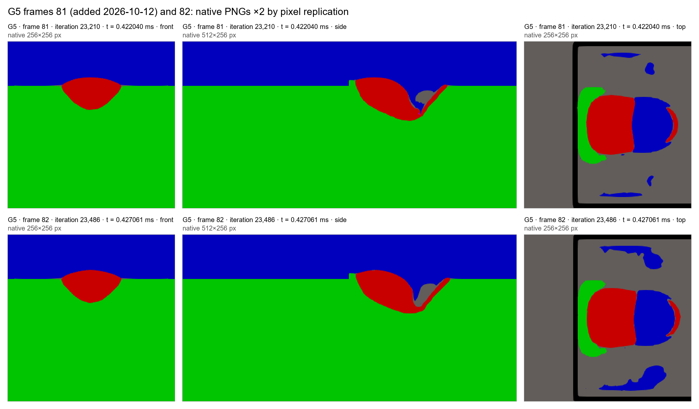

# Gallery addendum (2026-10-12): G5 frame 81

The Week 19 gallery (`../../week19_temporal_regime_dev_pilot/ioan_gallery/GALLERY.md`) is unchanged.

**What is added.** Frame 81 of G5 in front, side and top views, fetched at the pinned NEW revision `2e1eec9c98fd57609d2815f174586336ab59da07` and verified by LFS SHA-256 (`image_inventory_addendum.csv`). All three images are usable.

**Timing.**

| Frame | Iteration | Monitor time (ms) | Offset from G5's maximum-depth time |
|---:|---:|---:|---:|
| 81 (added) | 23,210 | 0.422040 | -4.84 µs before |
| 82 (already linked) | 23,486 | 0.427061 | +0.18 µs after |

G5's maximum-depth time is 0.426879 ms.

**Originals, frame 81:** [front](https://huggingface.co/datasets/ioandanielc/sph_v2/resolve/2e1eec9c98fd57609d2815f174586336ab59da07/P-387p361336282_VX-0p960187357846_LS-4p72484046084e-05_ST-390p52586458_M-TI64_XI-0p0002_XF-0p0014_XL-0p0012_TE-0p0021_DT-5p02414509376e-06_H-b302fc6cbd/frames/front/frame_00081.png) · [side](https://huggingface.co/datasets/ioandanielc/sph_v2/resolve/2e1eec9c98fd57609d2815f174586336ab59da07/P-387p361336282_VX-0p960187357846_LS-4p72484046084e-05_ST-390p52586458_M-TI64_XI-0p0002_XF-0p0014_XL-0p0012_TE-0p0021_DT-5p02414509376e-06_H-b302fc6cbd/frames/side/frame_00081.png) · [top](https://huggingface.co/datasets/ioandanielc/sph_v2/resolve/2e1eec9c98fd57609d2815f174586336ab59da07/P-387p361336282_VX-0p960187357846_LS-4p72484046084e-05_ST-390p52586458_M-TI64_XI-0p0002_XF-0p0014_XL-0p0012_TE-0p0021_DT-5p02414509376e-06_H-b302fc6cbd/frames/top/frame_00081.png).

Recorded labels and monitored depths for these frames are in [KEY_ADDENDUM.md](KEY_ADDENDUM.md).
